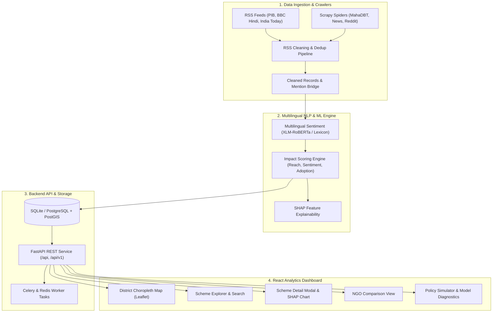

# Local Policy Impact Analyzer 🇮🇳

> **A full-stack AI/ML analytics platform for monitoring, evaluating, and visualizing the ground-level public impact of Indian government welfare schemes and policies.**

---

## 📌 Executive Summary

Government welfare programs disburse trillions of rupees annually, yet measuring their ground-level reach, citizen sentiment, and implementation hurdles across diverse districts remains challenging. 

The **Local Policy Impact Analyzer** addresses this by combining **multi-source automated web & news scraping**, **multilingual NLP sentiment analysis (Hindi, Hinglish, English)**, and **interpretable machine learning (SHAP)** with an **interactive geospatial dashboard**. It empowers citizens, policymakers, and NGOs to observe policy perception, compare regional adoption, and inspect feature-level explainability.

Designed with an on-device, local-first philosophy, the platform supports local inference with low latency, privacy preservation, and future hardware acceleration on Snapdragon / Windows on ARM platforms (via ONNX Runtime, DirectML, and QNN).

---

## 🏗️ System Architecture



---

## ✨ Key Features

### 1. Interactive React Dashboard (`frontend/`)
* **District Choropleth Map**: Geospatial visualization powered by Leaflet & OpenStreetMap displaying district-level policy impact scores across Maharashtra and India.
* **Scheme Explorer**: Real-time search and filtering across categories (Agriculture, Education, Social Welfare) and jurisdiction levels (Central vs. State).
* **SHAP Explainability Modal**: Transparent breakdowns showing the exact contribution of Reach, Sentiment, and Budget Adoption to any scheme's score.
* **NGO Comparison View**: Side-by-side comparison tool enabling policy analysts and NGOs to contrast schemes by budget, reach, and composite impact.
* **Policy Simulator & Diagnostics**: Interactive controls to simulate hypothetical policy adjustments and inspect model performance metrics.
* **Transparency Banner**: Clear indicators that scores are model-assisted estimates.

### 2. FastAPI Backend Service (`backend/`)
* **RESTful Endpoints**: Full CRUD and analytical endpoints covering schemes, regions, mentions, and comparisons.
* **Dual Database Support**: Seamless fallback to SQLite (`policy_impact.db`) for rapid local development or PostgreSQL/PostGIS in production.
* **Eager Relationship Loading**: Optimized SQLAlchemy queries eliminating N+1 overhead on nested relationships.
* **Interactive Documentation**: OpenAPI Swagger UI available out-of-the-box at `/docs`.

### 3. Data Collection & RSS Pipeline (`scraper/`)
* **Multi-Source Crawlers**: Scrapy spiders targeting government portals (MahaDBT), regional news portals, and community forums (Reddit).
* **Automated RSS Pipeline**: Feedparser-based collector ingesting feeds from PIB, BBC Hindi, India Today, and Navbharat Times.
* **Data Hygiene Engine**: Text sanitization, date normalization, language identification (Hindi, Hinglish, English), near-deduplication (threshold ≥ 0.85), and policy relevance filtering.
* **Mention Bridge**: Bridges raw and cleaned news mentions directly into database `Mention` and `Scheme` tables.

### 4. Multilingual NLP & Impact Scoring (`ml/`)
* **Multilingual Sentiment**: Hugging Face Transformer inference (`cardiffnlp/twitter-xlm-roberta-base-sentiment` / MuRIL) and lexicon analyzers tuned for Indian regional context and Hinglish colloquialisms.
* **Composite Impact Score Model**:
  $$\text{Impact Score} = 0.4 \times \text{Reach} + 0.3 \times \text{Sentiment} + 0.3 \times \text{Adoption}$$
* **Explainable AI (XAI)**: SHAP value contributions decomposing each score into interpretable positive and negative factors.

---

## 📂 Repository Structure

```
local-policy-impact-analyzer/
├── backend/                        # FastAPI REST API Backend
│   ├── app/
│   │   ├── api/endpoints.py        # Core API routers (/api/schemes, /api/regions, etc.)
│   │   ├── core/                   # Configuration & database engine setup
│   │   ├── models/models.py        # SQLAlchemy ORM models (Scheme, Region, Mention, ImpactScore)
│   │   ├── schemas/schemas.py      # Pydantic v2 validation models
│   │   ├── tasks/celery_app.py     # Celery background workers
│   │   ├── main.py                 # FastAPI application factory & CORS setup
│   │   ├── model_provider.py       # ML model provider seam
│   │   ├── seed.py                 # Maharashtra baseline seeder
│   │   └── seed_india.py           # Pan-India expanded district seeder
│   ├── requirements.txt            # Backend dependencies
│   └── Dockerfile                  # Backend container build
│
├── frontend/                       # React 19 + TypeScript + Vite Dashboard
│   ├── src/
│   │   ├── components/
│   │   │   ├── DistrictMap.tsx     # Leaflet Choropleth map with district score coloring
│   │   │   ├── SchemeCard.tsx      # Individual scheme metrics card
│   │   │   ├── SchemeDetailModal.tsx # SHAP breakdown and recent sentiment feed
│   │   │   ├── ComparisonView.tsx  # NGO side-by-side scheme comparison
│   │   │   ├── PolicySimulator.tsx # What-if scenario simulator
│   │   │   ├── ModelDiagnostics.tsx# Model health and error metrics
│   │   │   └── DisclaimerBanner.tsx# Ethics & transparency disclaimer
│   │   ├── App.tsx                 # Main dashboard UI layout
│   │   └── api.ts                  # Axios/Fetch client with fallback data
│   ├── package.json
│   └── vite.config.ts
│
├── ml/                             # Machine Learning & Sentiment Processing
│   ├── analyze_and_populate.py     # Batch sentiment & SHAP computation runner
│   ├── sentiment_analyzer.py       # Multilingual sentiment scoring module
│   └── requirements.txt
│
├── scraper/                        # Web Scraping & Ingestion
│   ├── local_policy_scraper/       # Scrapy project (MahaDBT, News, Reddit)
│   ├── rss/                        # Refactored SQLAlchemy RSS pipeline
│   │   ├── rss_pipeline.py         # Feedparser RSS collector
│   │   ├── integration.py          # Cleaner, deduplicator & relevance flagger
│   │   ├── mention_bridge.py       # Bridge to backend DB tables
│   │   └── sentiment.py            # Lexicon sentiment helper
│   └── scrapy.cfg
│
├── cleaned_policy_data.csv         # Cleaned articles with duplicate & relevance flags
├── nlp_ready_data.csv              # Filtered dataset ready for NLP inference
├── nlp_policy_impact_results.csv   # Persisted sentiment & impact score results
├── nlp_processor.py                # Standalone XLM-RoBERTa sentiment processor
├── docker-compose.yml              # PostgreSQL/PostGIS, Redis, Celery orchestration
├── start.ps1                       # One-click Windows PowerShell dev launcher
└── requirements.txt                # Unified root Python dependencies
```

---

## 🚀 Quick Start Guide

### Prerequisites
* **Python**: 3.10 or newer
* **Node.js**: 18.0 or newer (with npm)
* **Git**

---

### Option A: One-Click Startup (Windows PowerShell)

Run the included startup script from the project root:

```powershell
.\start.ps1
```

This automatically:
1. Detects your virtual environment (`.venv`).
2. Launches the **FastAPI Backend** on `http://localhost:8000`.
3. Launches the **React Dashboard** on `http://localhost:3000`.
4. Opens your default web browser directly to the dashboard.

---

### Option B: Manual Setup

#### 1. Backend Setup
```bash
# From repository root:
python -m venv .venv

# Activate virtual environment:
# On Windows (PowerShell):
.venv\Scripts\Activate.ps1
# On Linux/macOS:
source .venv/bin/activate

# Install dependencies
pip install -r requirements.txt

# (Optional) Seed the database with sample schemes and districts
python -m backend.app.seed

# Start the FastAPI server
python -m uvicorn backend.app.main:app --host 127.0.0.1 --port 8000 --reload
```

* Backend Health Check: [http://127.0.0.1:8000/health](http://127.0.0.1:8000/health)
* Swagger Interactive Docs: [http://127.0.0.1:8000/docs](http://127.0.0.1:8000/docs)

#### 2. Frontend Setup
```bash
# Open a new terminal and navigate to frontend:
cd frontend

# Install Node dependencies
npm install

# Start Vite dev server
npm run dev -- --port 3000
```

* Dashboard UI: [http://localhost:3000](http://localhost:3000)

---

### Option C: Multi-Container Docker Deployment

To launch the full production stack including PostgreSQL/PostGIS, Redis, Celery, and MLflow:

```bash
docker-compose up -d
```

---

## 📡 API Reference

| Method | Endpoint | Description |
|---|---|---|
| `GET` | `/health` | Health status and database connectivity |
| `GET` | `/api/schemes` | List schemes with search, category filters, and average impact scores |
| `GET` | `/api/schemes/{id}` | Scheme details, regional impact scores, SHAP contributions, and recent mentions |
| `POST` | `/api/schemes` | Register a new scheme and initialize regional baseline scores |
| `GET` | `/api/regions` | District list with demographic data and GeoJSON coordinates |
| `GET` | `/api/regions/{id}/schemes` | Impact scores across all schemes for a specific district |
| `GET` | `/api/comparison` | Side-by-side comparison of two schemes |
| `GET` | `/api/mentions` | Filtered list of scraped public mentions with sentiment labels |
| `POST` | `/api/mentions` | Ingest a new mention and dynamically recalculate scheme impact scores |
| `GET` | `/api/v1/dashboard/summary` | Aggregate dashboard summary (sentiment counts, source scores) |
| `GET` | `/api/v1/records` | Paginated raw article records with full-text search |

---

## 🔄 Running the Scrapers & NLP Pipeline

### 1. Ingest RSS Feeds & Clean
```powershell
# Ingest feeds from PIB, BBC Hindi, India Today
python -m scraper.rss.rss_pipeline

# Clean text, detect language, deduplicate and flag relevance
python -m scraper.rss.integration

# Bridge cleaned records into backend Mention & Scheme tables
python -m scraper.rss.run_rss_pipeline
```

### 2. Run NLP Sentiment & Impact Scoring
```powershell
# Run XLM-RoBERTa transformer inference and export scores
python nlp_processor.py

# Or run the batch ML analyzer and populate the database
python -m ml.analyze_and_populate
```

---

## ⚖️ Interpretation & Transparency Disclaimer

> **Notice:** The impact scores generated by this platform are **model-assisted statistical estimates** combining online public discourse, reported sentiment, and published scheme metrics. 
> 
> Online discussions represent public sentiment signals and do not constitute an official or exhaustive audit of whether a scheme reached individual beneficiaries. Factors such as regional digital literacy, linguistic nuances, internet access distribution, and news editorial bias can influence sentiment feeds. These scores are designed to assist researchers and policymakers in prioritizing ground evaluations, not to replace official governmental audits.

---

## 🛠️ Technology Stack

| Layer | Technology |
|---|---|
| **Frontend** | React 19, TypeScript, Vite, Tailwind CSS, Leaflet, Lucide Icons, Recharts |
| **Backend** | FastAPI, Pydantic v2, SQLAlchemy 2.0, Uvicorn |
| **Databases** | SQLite (development) / PostgreSQL with PostGIS (production) |
| **NLP & ML** | Hugging Face Transformers (`XLM-RoBERTa`), PyTorch, SHAP, NumPy, Pandas |
| **Crawling** | Scrapy, Feedparser, BeautifulSoup4, Requests |
| **DevOps & Async** | Docker, Docker Compose, Celery, Redis, MLflow |

---

## 📄 License

This project is licensed under the MIT License — see the [LICENSE](LICENSE) file for details.
